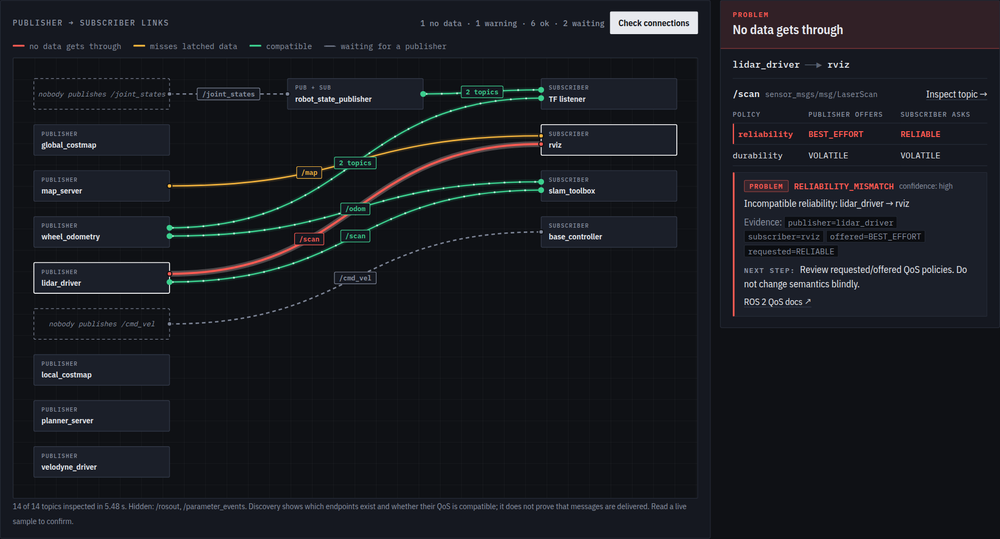

# DDS AutoDiag

[](https://github.com/Animesh2507/dds-autodiag/actions/workflows/ci.yml)
[](https://github.com/Animesh2507/dds-autodiag/actions/workflows/docs.yml)


[](LICENSE)

**AI-powered diagnostics for ROS 2: find out why your nodes can't talk, see every broken connection, and let AI guide the fix.**

## The problem

ROS 2 communication fails silently. The topic shows up in `ros2 topic list`, both nodes are running, and yet:

- no message ever arrives, or RViz stays empty, with **no error and no warning**;
- the robot and your laptop (or two containers) **never see each other**;
- the map shows up only if RViz starts first, or never.

The cause is usually one mismatched setting: QoS reliability or durability, `ROS_DOMAIN_ID`, discovery range, RMW
(Zenoh vs DDS), shared memory between containers, a missing DDS XML file. Finding it takes hours.

**DDS AutoDiag finds it in seconds.** It checks 23 known causes, shows the evidence, tells you exactly what to change,
links the official docs, and can fix your RViz view for you. It is **read-only**: it never touches your robot or
ROS configuration.



## Quick start

```bash
sudo apt install python3-venv  # once: Ubuntu doesn't ship it by default
git clone https://github.com/Animesh2507/dds-autodiag.git && cd dds-autodiag
source /opt/ros/jazzy/setup.bash
python3 -m venv --system-site-packages .venv && source .venv/bin/activate
pip install .

dds-autodiag doctor            # is this machine ready?
dds-autodiag demo              # see it work in a minute: two broken demo topics, diagnosed
dds-autodiag inspect /scan     # why is this topic silent?
dds-autodiag serve --open      # dashboard at http://127.0.0.1:8080
```

Or without installing anything, with Docker (host networking so it sees your ROS graph):

```bash
docker run --rm --net=host --ipc=host ghcr.io/animesh2507/dds-autodiag:0.1.0          # dashboard
docker run --rm --net=host --ipc=host ghcr.io/animesh2507/dds-autodiag:0.1.0 check    # one-shot check
```

RViz panel: build `ros2/rviz_autodiag_panel` with colcon, then start the server and RViz together with
`ros2 launch rviz_autodiag_panel autodiag.launch.py`.

| Where | What |
|---|---|
| `dds-autodiag …` | CLI: `doctor`, `demo`, `check`, `topics`, `inspect`, `sample`, `collect`, `compare`, `selftest` |
| http://127.0.0.1:8080 | Dashboard: health, topics, graph, hosts, transport, tools, AI assistant |
| http://127.0.0.1:8080/api/docs | REST API (OpenAPI) |
| RViz → Panels → AutoDiag | Health, topic QoS, diagnosis graph, AI and Configure RViz next to your displays |

## What's included

| | Feature | |
|---|---|---|
| **Core** | **Diagnosis**: 23 rules with evidence, a next step and official docs where one applies; live topic QoS inspection; one-shot message sampling | CLI · dashboard |
| | **Diagnosis graph**: every publisher → subscriber connection, broken ones in red, fix one click away | dashboard · RViz panel |
| | **RViz2 panel**: health, topic QoS, the diagnosis graph and AI, right next to your displays | `ros2/rviz_autodiag_panel` |
| **AI add-ons** | **Assistant**: answers grounded in official ROS 2 / DDS docs, streamed, with follow-ups | Local Ollama or Claude, ChatGPT, Gemini |
| | **Configure RViz**: describe the view; every change is validated against your live system, applied on confirmation, undoable | RViz panel |
| **Extras** | Compare hosts and containers, Markdown reports, redacted snapshots, Docker image, systemd service | |
| **Experimental** | Native C++ endpoint checker, the previous UI at `/legacy` | May change or be removed before 1.0 |

AI is optional: without it, diagnosis and documentation search still work fully offline.
Which model to pick? See the [AI model benchmark](docs/reference/ai-benchmark.md) (cloud and local, with
`dds-autodiag bench` to run it on your machine).

## Documentation

Guides, architecture and reference live in [`docs/`](docs/). To browse them as a website:

```bash
pip install ".[docs]" && mkdocs serve      # http://127.0.0.1:8000
```

Good starting points: [Quick start](docs/getting-started/quickstart.md) ·
[Configure RViz with AI](docs/guides/configure-rviz.md) · [Diagnostic rules](docs/reference/rules.md) ·
[Architecture](docs/architecture/index.md) · [Security model](docs/concepts/security.md)

## Status

Version **0.1.0** (unreleased). Tested on ROS 2 Jazzy with Fast DDS on Ubuntu 24.04. Smoke-tested on Humble
(`doctor`, rule self-test, `demo`, `check`, `inspect` in `ros:humble-ros-base`). Reports from other distros,
RMWs and setups are very welcome; see [Contributing](docs/contributing.md).

**Related tools:** [greenwave_monitor](https://github.com/NVIDIA-ISAAC-ROS/greenwave_monitor),
[ros2_pulse](https://github.com/TanayK07/ros2_pulse) and [ROSscope](https://github.com/jawad-glitch/ROSscope) monitor
topic rates, latency and health over time; DDS AutoDiag explains *why* communication fails and how to fix it. They
work well together.

## License

MIT. See [LICENSE](LICENSE).
