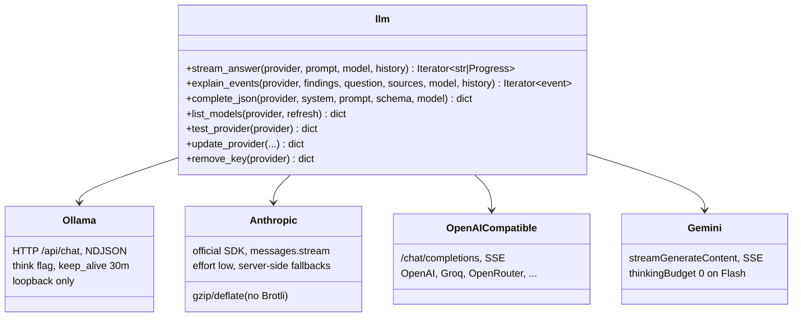
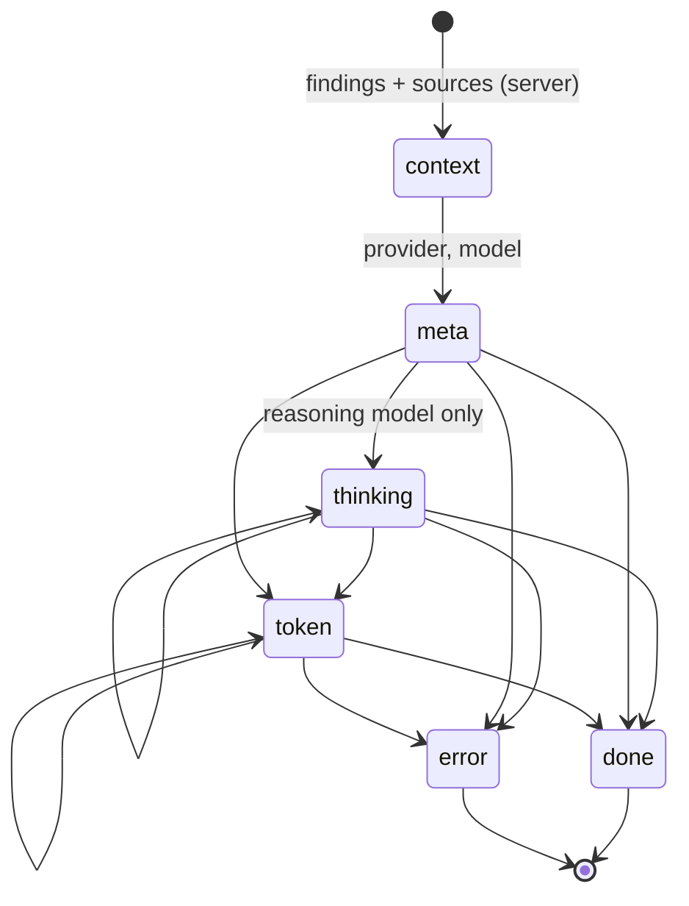

# AI layer

**Modules:** `rag.py` (retrieval), `llm.py` (providers, streaming, keys, structured output)

The AI layer has two jobs: **retrieve** the right documentation, and **talk to models** through one interface,
whichever provider is selected. The user-facing explanation is in [RAG & AI pipeline](../../concepts/rag.md); this
page covers the internals.

--8<-- "assets/diagrams/rag.svg"

## Provider abstraction

Every provider is reduced to two operations:

| Operation | Used by | Output |
|---|---|---|
| **Streaming text** (`stream_answer`) | Assistant | Text chunks (plus `Progress` items while a local model reasons) |
| **Structured JSON** (`complete_json`) | RViz planner | One JSON object matching a schema |

Structured output uses each provider's strongest mechanism: Ollama's `format` schema, Claude's
`output_config.format`, OpenAI's strict `json_schema`, Gemini's JSON MIME type plus the schema in the prompt.
Providers without one (OpenAI-compatible) get the schema in the prompt, and a tolerant parser extracts the first JSON
object.

## Streaming events

`explain_events()` wraps any provider into one event stream, which the server sends as NDJSON:

Answers are capped at 12,000 characters; `thinking` progress is throttled to one event per 150 characters.

## Conversation history

`conversation()` turns client-sent history into a valid message list for every provider: it keeps the last 8
messages, caps each at 2,500 characters, merges consecutive same-role messages, drops leading assistant turns, and
appends the new prompt. Gemini's `model` role is mapped automatically.

## Local model handling

- **Model choice:** an explicit setting wins; otherwise `qwen3:4b-instruct` is preferred over `qwen3:4b`.
- **Thinking-only detection:** `/api/show` reports `general.finetune: Thinking` for reasoning-only models. They get
  `think: true` (so reasoning stays out of the answer) and a larger token budget; their reasoning is reported as
  progress. A `<think>` filter removes inline reasoning from models that emit it anyway.
- **Warm-up:** the dashboard and panel call `/api/ai/warmup`, which loads the model in the background.
- **Caching:** installed-model lists for 30 s, thinking detection for 5 min, cloud model lists for 10 min.

## Cloud masking

When `llm.is_cloud(provider)` is true, the server passes findings (assistant) or the planner prompt (RViz) through
`redact.mask_for_cloud()` first: node names become `publisher 1`, `subscriber 1`, …, and this machine's hostname, IP
addresses and home paths are replaced with tokens. QoS, topic names, message types and rule codes are kept. Local
Ollama gets the real names, and the UI always shows them. See [Security model](../../concepts/security.md).

## Keys

Keys are stored in `ai-providers.json` (mode `0600`, written atomically via a temp file and `os.replace`).
Environment variables take precedence. `provider_status()` exposes only whether a key exists and its last four
characters. See [Security model](../../concepts/security.md#api-keys).

## Error handling

All provider failures become `ProviderError` with a user-presentable message that never contains a key: rejected
key, missing model, rate limit, timeout, or a named local failure. Anything unexpected is reported by exception type
only.
