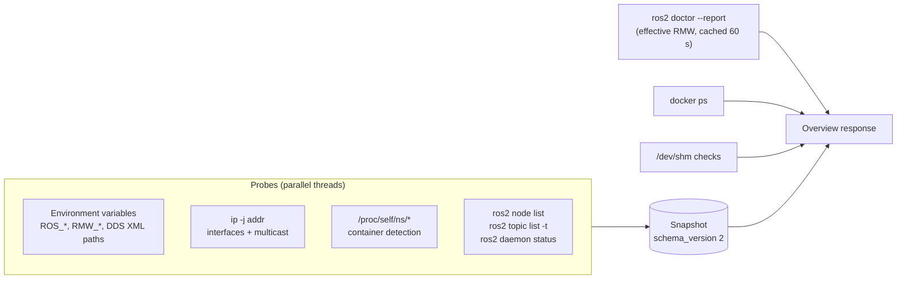

# Collector & probes

**Modules:** `collector.py`, `live.py`, `enhanced.py`, `remote.py`, `redact.py`

The collector turns "this machine" into a **snapshot**: a JSON document of facts that the rule engine can evaluate
and that can be saved, redacted and compared with another machine.

## Probes

| Probe | Command / source | Timeout | Notes |
|---|---|---|---|
| Environment | `os.environ` | — | Only an allow-list of ROS/DDS variables is recorded |
| DDS config files | `CYCLONEDDS_URI`, `FASTDDS_DEFAULT_PROFILES_FILE` | — | Records whether the file exists; never reads its content |
| Network | `ip -j addr show` | 3 s | Name, state, MTU, multicast flag, addresses |
| Container | `/.dockerenv`, `/proc/1/cgroup`, `/proc/self/ns/{ipc,net,pid}` | — | Namespace IDs make IPC comparisons possible |
| ROS graph | `ros2 node list` / `topic list` with `--no-daemon --spin-time N` | 5 s + N | `N = AUTODIAG_DISCOVERY_SECONDS` (default 2) |
| Effective RMW | `ros2 doctor --report` | 15 s | Output cap raised to 500 kB; result cached 60 s |
| Docker | `docker ps --format '{{json .}}'` | 5 s | Optional |
| Topic inspection | `ros2 topic info --verbose` | 8 s + N | Parsed into endpoints with QoS |
| Sample | `ros2 topic echo --once` | 1–15 s | Optional reliability override; output capped at 16 kB |

## Rules for every probe

- **No shell.** Commands run as argument lists through `subprocess.run`; topic names are validated against a strict
  pattern before use.
- **Bounded.** Every call has a timeout and an output cap. A timeout is reported as a state, never as a crash.
- **Daemon-independent.** `ROS2CLI_DISABLE_DAEMON=1` and `--no-daemon` avoid stale daemon caches.
- **Read-only.** No probe starts, stops or reconfigures anything.

## Why wait for discovery?

With `--no-daemon`, the `ros2` CLI creates a fresh DDS participant per call. Without a spin time it often returns
before discovery completes, and node and topic counts change between refreshes. The configurable wait trades a
couple of seconds for consistent results; see [ADR-007](../decisions.md#adr-007-wait-for-dds-discovery-in-graph-queries).

## Remote snapshots

`remote.py` fetches a peer's snapshot from `/api/agent/snapshot`:

- numeric private or loopback IPs only, no hostnames (avoids DNS-based tricks);
- proxies disabled and redirects refused, so the token can't leak;
- response capped at 300 kB and schema-checked.

## Redaction

`redact.py` walks the snapshot and replaces hostnames, IPv4/IPv6 addresses and home paths with salted SHA-256
tokens (`host-1a2b3c4d`). Loopback and multicast addresses are kept because they carry diagnostic meaning. The same
salt on two machines produces the same tokens, so redacted snapshots still compare correctly.
