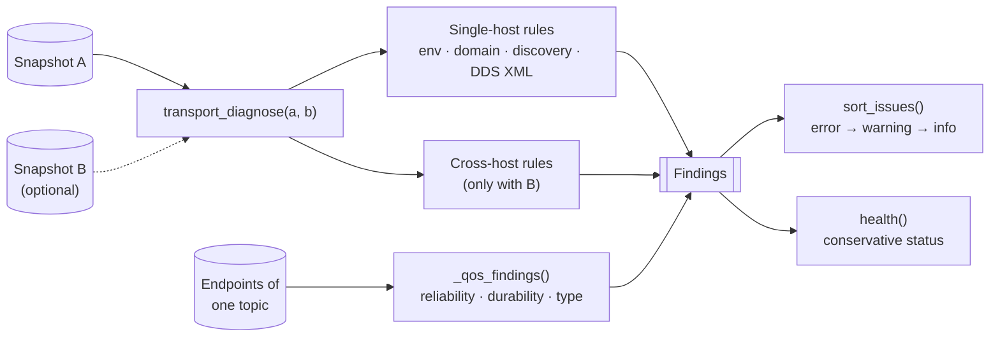

# Rule engine

**Modules:** `transport.py` (host and cross-host rules), `live.py` (QoS rules on live topics), `knowledge.py`
(documentation links), `validation.py` (fixtures), `report.py` (`sort_issues`, Markdown report), `agent.py` (next-test
hints), `rules_doc.py` (generates [Diagnostic rules](../../reference/rules.md))

The rule functions (`transport_diagnose`, `_environment_rules`, `live._qos_findings`) are **pure**: snapshots or
endpoints in, findings out. No I/O, no global state, which makes every rule trivially testable. Collecting the input
(`ros2 topic info --verbose` for live rules) happens outside them.



## Anatomy of a rule

```python
if domain_a != domain_b:
    issues.append(_issue(
        'DOMAIN_MISMATCH', 'error',                      # code, severity
        'Different ROS_DOMAIN_ID values',                # summary
        {'host_a': domain_a, 'host_b': domain_b},        # evidence
        'Use a consistent ROS_DOMAIN_ID across intended peers, then restart managed processes.',
        'domain', 'high'))                               # documentation key, confidence
```

`_issue()` resolves the documentation key to an official URL from `knowledge.py`, so rules never contain URLs.

## Rule families

| Family | Needs | Examples |
|---|---|---|
| Environment | One snapshot | `ROS_ENV_NOT_SOURCED`, `INVALID_DOMAIN_ID`, `DISCOVERY_DISABLED` |
| Cross-host | Two snapshots | `DOMAIN_MISMATCH`, `RMW_MISMATCH`, `DISCOVERY_RANGE_RESTRICTED` |
| Transport | A requested mode | `SHM_IPC_NAMESPACE_DIFFERENCE`, `INTRA_PROCESS_SEPARATE_PROCESSES` |
| Live QoS | Topic endpoints | `RELIABILITY_MISMATCH`, `DURABILITY_MISMATCH`, `TYPE_MISMATCH` |

The full list is in [Diagnostic rules](../../reference/rules.md).

## Health is conservative

`health()` reports one of three states:

| State | When |
|---|---|
| `issue_detected` | At least one error-severity finding |
| `insufficient_evidence` | No errors, but something is unknown, unavailable, *not tested* or *not verified* |
| `healthy` | Only when every check is positively confirmed |

Data flow (`topic_data_flow`, `application_nodes`) and the selected transport (`dds_transport`, `intra_process`) are
never verified from configuration, so today a clean configuration always ends in `insufficient_evidence`; `healthy`
is reserved for future positive checks. That's intentional: see
[ADR-002](../decisions.md#adr-002-deterministic-rules-decide-ai-explains).

## Self-test fixtures

Every rule has at least one synthetic fixture in `validation.py` (27 fixtures for 23 rules): one or two snapshots run
through `transport_diagnose()`, or a list of `endpoints` run through `_qos_findings()`, that must trigger it. Two
negative fixtures (matching domains, compatible QoS) must not report a mismatch. `run_all()` powers
`dds-autodiag selftest`, `/api/selftest` and the dashboard **Tool check**, so any installation can prove its rules work
without a robot. `live_rule_check()` / `POST /api/live-rules` (dashboard **Live rule check**) applies the same
published codes to this host, an optional peer snapshot and this host’s live graph. `rules_doc.py` runs the fixtures
to generate the rules page; a test fails if the page drifts.
