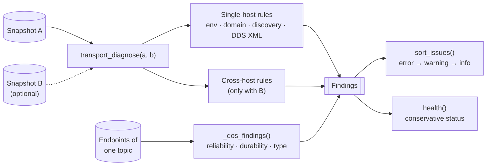

# Rule engine

**Modules:** `transport.py` (host and cross-host rules), `live.py` (QoS rules on live topics), `knowledge.py`
(documentation links), `validation.py` (fixtures), `agent.py` (next-test hints)

The rule engine is a set of **pure functions**: snapshots in, findings out. No I/O, no global state, which makes every
rule trivially testable.



## Anatomy of a rule

```python
if domain_a != domain_b:
    issues.append(_issue(
        'DOMAIN_MISMATCH', 'error',                      # code, severity
        'Different ROS_DOMAIN_ID values',                # summary
        {'host_a': domain_a, 'host_b': domain_b},        # evidence
        'Use a consistent ROS_DOMAIN_ID across intended peers, then restart managed processes.',
        'domain', 'high'))                               # documentation key, confidence
```

`_issue()` resolves the documentation key to an official URL from `knowledge.py`, so rules never contain URLs.

## Rule families

| Family | Needs | Examples |
|---|---|---|
| Environment | One snapshot | `ROS_ENV_NOT_SOURCED`, `INVALID_DOMAIN_ID`, `DISCOVERY_DISABLED` |
| Cross-host | Two snapshots | `DOMAIN_MISMATCH`, `RMW_MISMATCH`, `DISCOVERY_RANGE_RESTRICTED` |
| Transport | A requested mode | `SHM_IPC_NAMESPACE_DIFFERENCE`, `INTRA_PROCESS_SEPARATE_PROCESSES` |
| Live QoS | Topic endpoints | `RELIABILITY_MISMATCH`, `DURABILITY_MISMATCH`, `TYPE_MISMATCH` |

The full list is in [Diagnostic rules](../../reference/rules.md).

## Health is conservative

`health()` reports one of three states:

| State | When |
|---|---|
| `issue_detected` | At least one error-severity finding |
| `insufficient_evidence` | No errors, but something is unknown, unavailable, *not tested* or *not verified* |
| `healthy` | Only when every check is positively confirmed |

Because data flow and the selected transport can't be observed from configuration, a clean configuration normally
ends in `insufficient_evidence`, not `healthy`. That's intentional: see
[ADR-002](../decisions.md#adr-002-deterministic-rules-decide-ai-explains).

## Self-test fixtures

Every rule has a synthetic fixture in `validation.py`: a minimal pair of snapshots that must trigger it (or, for the
"same domain" fixture, must not). `run_all()` powers `dds-autodiag selftest`, `/api/selftest` and the dashboard's
self-test, so any installation can prove its rules work without a robot.
