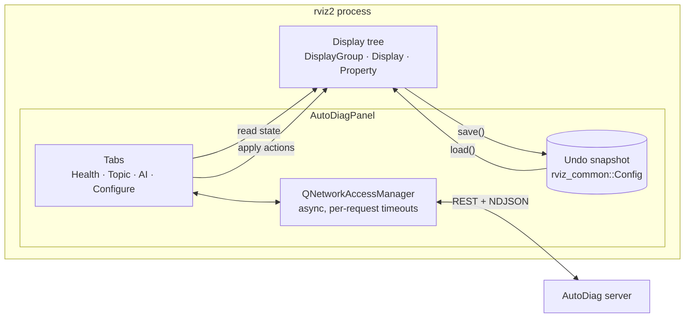
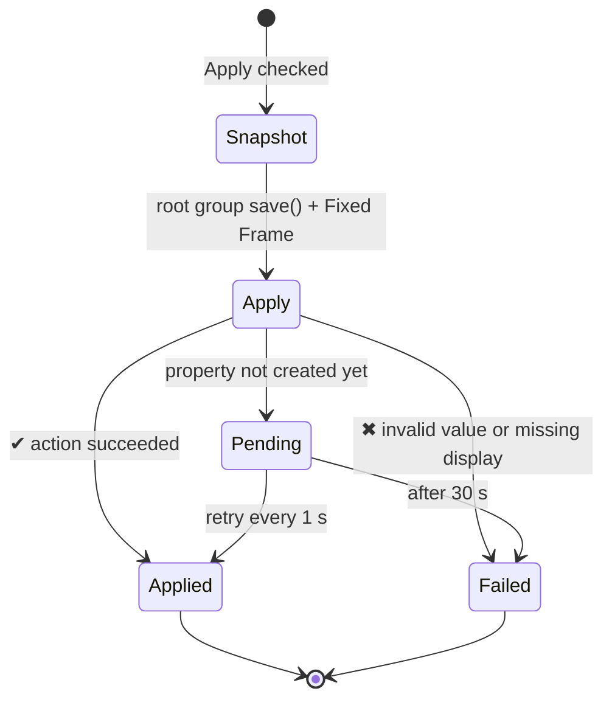

# RViz panel

**Package:** `ros2/rviz_autodiag_panel` · **Files:** `autodiag_panel.cpp` (connection, Health, Topic, AI
assistant), `configure_tab.cpp` (Configure RViz)

The panel is an `rviz_common::Panel` plugin exported through pluginlib. It is deliberately **thin**: it collects RViz
context, talks to the server, and applies validated plans. All diagnosis and AI logic stays on the server.

## Reading RViz state

`rvizState()` walks the display tree (including nested groups) and collects each display's name, class, enabled
flag, status level and up to 40 properties (two levels deep, e.g. `Topic/Reliability Policy`), plus the Fixed Frame
and the TF frames from the frame manager. Properties are found by name without `subProp()`, which would log
"Undefined property" errors for missing ones.

## Applying a plan

- **Add display:** `DisplayGroup::createDisplay(class_id)`, then name, topic and enable.
- **Set property:** string values are converted to the property's type (bool, number, color as `r; g; b`, enum
  text). A value RViz already has counts as success.
- **Pending:** some properties (for example point-cloud `Axis`) only exist once data arrives, so they are retried.
- **Undo:** the root display group and Fixed Frame saved before Apply are restored with `load()`.

## Asynchronous by design

Every request is non-blocking, so RViz keeps rendering while plans and answers arrive:

| Request | Timeout |
|---|---|
| Status, overview, topics, topic inspection, providers, models | 5–30 s (overview 30 s, topic inspection 25 s) |
| AI answer stream | 300 s (local CPU models) |
| RViz plan | 300 s |

The AI stream is parsed line by line as NDJSON and rendered as Markdown, with `[doc-id]` citations turned into links.

## State and persistence

| State | Where | Lifetime |
|---|---|---|
| Server URL, provider, model, topic, "Include the topic", "every 30 s" | `.rviz` config | Saved with the RViz config; a saved URL overrides `AUTODIAG_SERVER_URL` |
| Access token | Field or `AUTODIAG_UI_TOKEN` | Never saved |
| Conversation history (both AI tabs) | Panel memory | Session only |
| Provider / model selection | Shared by the AI and Configure tabs | Kept in sync both ways |
