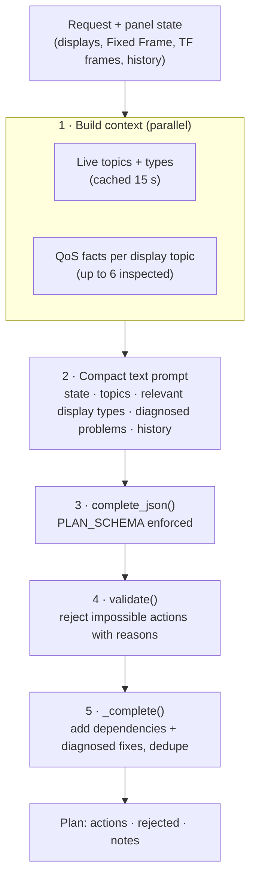

# RViz planner

**Module:** `rviz_agent.py` · **Endpoint:** `POST /api/rviz/plan`

The planner turns a plain-language request into a list of RViz actions that are safe to apply. The model only
*proposes*; the planner decides what reaches the user.

--8<-- "assets/diagrams/configure-rviz.svg"

## Pipeline

## The action vocabulary

The model can only use seven actions, each with the same flat schema (unused fields are empty strings):

| Action | Required fields |
|---|---|
| `add_display` | `display_type`, `topic` (empty for TF, Grid, Axes), `display` (name) |
| `remove_display` | `display` |
| `set_topic` | `display`, `topic` |
| `set_property` | `display`, `property`, `value` |
| `set_enabled` | `display`, `value` (`true`/`false`) |
| `rename_display` | `display`, `value` |
| `set_fixed_frame` | `frame` |

A flat schema is easy for small local models to follow and works with every provider's structured-output mode.

## Display catalog

`CATALOG` maps 24 RViz2 display types to their `rviz_default_plugins` class id, accepted message types, topic
property, and the settable properties with allowed values. The prompt is slimmed by retrieval
(`_retrieve_types`): words in the request (and in the last two requests, for follow-ups) select the display types it
needs (`TYPE_WORDS`: "cloud" → PointCloud2, "costmap" → Map, "footprint" → Polygon…), plus topics named in the request,
displays it names, and displays that currently show a warning or error. Only those types, their topics and their
displays' full settings go into the prompt; other displays get one line. If nothing matches, the full catalog is used
as before. On the [benchmark](../../reference/ai-benchmark.md) this cut prompt tokens by ~44% and plan time by ~35% for
a local 4B model, with no loss in accuracy. For cloud providers the finished prompt is passed through
`redact.mask_for_cloud()`, which replaces this machine's hostname, IP addresses and home paths with tokens.

## Validation

| Check | Result |
|---|---|
| Unknown action or display type | Rejected with reason |
| Target display doesn't exist | Rejected, unless it's added earlier in the same plan; names match loosely (`laser_scan` = `LaserScan`) |
| Topic exists with the wrong message type | Rejected, naming the topic's type (and, on `add_display`, the types the display accepts) |
| Topic doesn't exist (yet) | Allowed, marked **not publishing yet** |
| Missing topic on `add_display` | The single live topic of that type, else a conventional default (`/scan`, `/points`, …) |
| Property unknown to the display | Rejected when an existing display reported its properties and the name is in neither those nor the catalog; any property passes for a display added in the same plan. Nested paths like `Color Transformer/Axis` are normalized |
| Frame not in the TF tree | Allowed with a note |

## Deterministic completion

After validation, `_complete()` adds what the model tends to miss, each marked as automatic:

- **Dependencies:** `Axis` needs `Color Transformer: AxisColor`; `Color` needs `FlatColor`.
- **Diagnosed QoS fixes:** if a display requests Reliable from a Best Effort publisher (or Transient Local from a
  Volatile one), the fix is added, and a model-proposed "disable this display" is unchecked. A Volatile display on a
  latched (Transient Local) publisher, which misses data published before it started, gets Transient Local; a Best
  Effort one gets Reliable, because the latched sample only reaches Reliable readers.
- **Publisher QoS wins:** `_required_qos()` derives what a display must request from its publishers. A model setting
  that conflicts (e.g. Best Effort on the latched `/robot_description`) is corrected in place. The settings use the
  display's topic property, so `Topic/...` on a RobotModel becomes `Description Topic/...`.
- **Requested frame:** if the request mentions "frame" and exactly one TF frame name from the tree appears in it,
  that frame is applied when the model skipped it.
- **Deduplication:** repeated settings of the same property keep the first.

## Conversation context

The last four turns are summarized for the model, including what *really* happened: applied, skipped by the user,
failed (with reason), waiting for data, or undone. The live context remains the source of truth.
