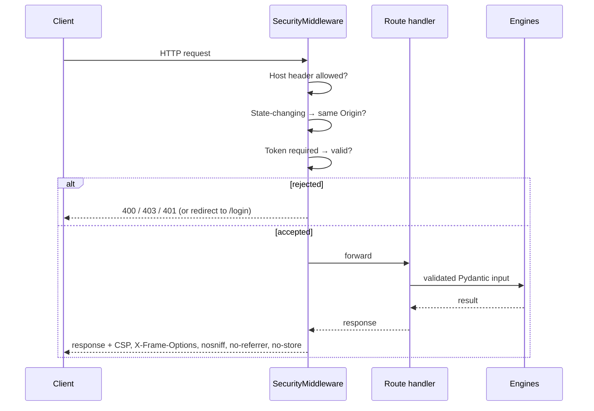

# Server & security middleware

**Modules:** `server.py`, `security.py`, `config.py`, `cli.py` (`serve`)

The server is a FastAPI application that exposes the engines over HTTP, serves the dashboard, and enforces the
security policy for every request.

## Request lifecycle

Unhandled exceptions are logged server-side and returned as a generic `500` naming only the exception type, so
command output and internals never reach the client.

## Route groups

| Group | Examples | Notes |
|---|---|---|
| Service | `/api/healthz`, `/api/version` | `healthz` is public for supervisors |
| Snapshot & diagnosis | `/api/v09/overview`, `/api/compare`, `/api/report` | Overview runs collector and capability probes in parallel |
| Live graph | `/api/topics`, `/api/topic-inspect`, `/api/topic-sample` | Wrap `live.py` |
| Endpoint check | `/api/endpoint-check` | Native C++ core when built, else the Python fallback in `core.py`; both emit the same codes ([Endpoint check](../../reference/rules.md#endpoint-check)) |
| AI | `/api/assistant/stream`, `/api/rviz/plan`, `/api/ai/providers/*` | Streaming via `StreamingResponse` |
| Collector | `/api/agent/snapshot` | Always routed, but answers `403` unless `AUTODIAG_AGENT_TOKEN` is set; token in `X-Autodiag-Token` |
| UI | `/`, `/static/*`, `/login`, `/legacy`, `/api/docs` | Strict CSP (no inline script); `/legacy` and `/api/docs` allow inline |

The full list is in the [REST API reference](../../reference/rest-api.md).

## Configuration

`config.settings()` reads `AUTODIAG_*` variables on every call instead of caching them at import time, so tests and
long-running servers always see the current values. `public_settings()` is the only view of configuration exposed to
clients and never contains secrets.

## Safe startup

`dds-autodiag serve` refuses to bind to a non-loopback address unless `AUTODIAG_UI_TOKEN` is set (or
`--insecure-no-auth` is passed explicitly), and warns when ROS 2 isn't sourced. See
[Security model](../../concepts/security.md).
