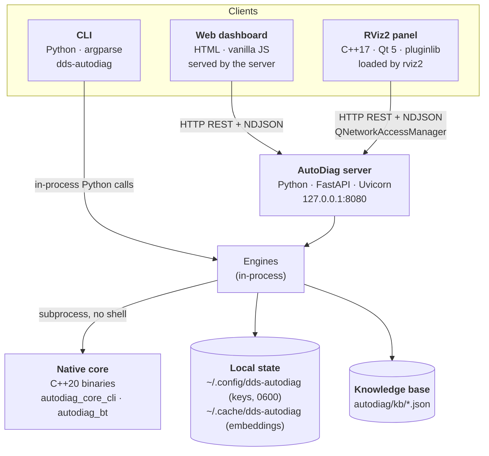

# Containers

In C4 terms, a *container* is a separately running or deployable part. AutoDiag has one central server process and
several clients.

| Container | Technology | Runs as | Talks to |
|---|---|---|---|
| **Server** | FastAPI, Uvicorn, Pydantic | `dds-autodiag serve`, systemd user unit, or Docker | Probes the system, calls AI providers, serves the dashboard |
| **CLI** | argparse | One-shot process | Imports the engines directly, no server needed (except `serve`) |
| **Web dashboard** | Static HTML/CSS/JS, no framework | Browser | Server REST API and NDJSON stream |
| **RViz2 panel** | C++17, Qt Widgets/Network, `rviz_common` | Plugin inside `rviz2` | Server REST API and NDJSON stream; RViz display API |
| **Native core** | C++20, CMake, CTest, BehaviorTree.CPP | Subprocess per request | Called by the server with argument lists, JSON on stdout |

## Communication

| From → to | Protocol | Notes |
|---|---|---|
| Dashboard / panel → server | HTTP/JSON | Same API for both clients; bearer token or cookie when enabled |
| Server → clients (AI) | NDJSON over HTTP | One JSON event per line: `context`, `meta`, `thinking`, `token`, `done`/`error` |
| Server → ROS 2 | `ros2` CLI subprocesses | `--no-daemon` with a discovery wait; timeouts and output caps |
| Server → native core | Subprocess | Fixed argument list, 5–8 s timeout, JSON / JSON-lines output |
| Server → Ollama | HTTP, loopback only | Streaming chat, embeddings, model list |
| Server → cloud AI | HTTPS | Official Anthropic SDK; REST with SSE for OpenAI-compatible and Gemini |
| Server → peer collector | HTTP | Private or loopback IP only, no proxy, no redirects, size-capped |

## Why a server at all?

The RViz panel could have called AI providers itself. Keeping one server means:

- **Keys live in one place**, never in `.rviz` files or the browser.
- **One implementation** of rules, retrieval and providers serves the CLI, dashboard and panel.
- The **panel stays thin**: it only adds RViz context and applies validated plans.

See [ADR-003](decisions.md#adr-003-a-local-server-shared-by-all-clients).

## Deployment views

=== "Developer laptop"

    `dds-autodiag serve` in a terminal with ROS 2 sourced; RViz panel built with colcon.

=== "Robot (systemd)"

    The user unit sources ROS 2 and starts the server on login (or on boot with `loginctl enable-linger`). Access
    via SSH tunnel, or token + allowed hosts.

=== "Docker"

    `--net=host --ipc=host` so the container sees the host's DDS graph and shared memory. Runs as a non-root user
    with a health check on `/api/healthz`.
