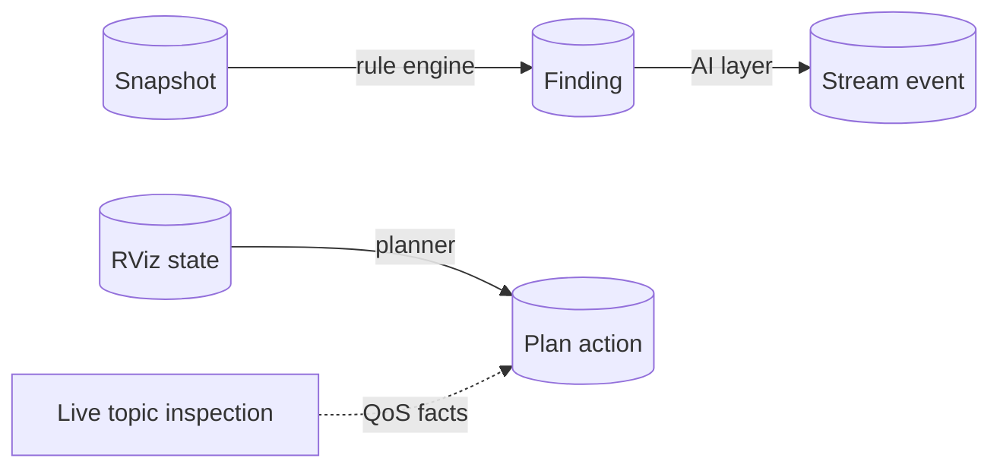

# Data model

Four JSON structures carry almost everything through the system.



## Snapshot

Produced by the collector; input to the rule engine; the unit of comparison between hosts.

```json
{
  "schema_version": 2,
  "tool_version": "0.1.0",
  "collected_at": "2026-10-15T08:30:00+00:00",
  "identity": {"host": "robot-1", "pid": 4242},
  "environment": {"ROS_DISTRO": "jazzy", "ROS_DOMAIN_ID": "7", "RMW_IMPLEMENTATION": "rmw_fastrtps_cpp"},
  "container": {"detected": false, "ipc_namespace": "ipc:[4026531839]", "net_namespace": "…", "pid_namespace": "…"},
  "network": {"interfaces": [{"name": "eth0", "state": "UP", "mtu": 1500, "multicast": true, "addresses": ["…"]}]},
  "config_files": {"CYCLONEDDS_URI": {"status": "missing"}},
  "transport": {"requested_mode": "auto", "observed_mode": "unknown", "reason": "…"},
  "ros": {"cli_available": true, "daemon": {"state": "running"}, "graph": {"state": "ok", "stdout": "…"}, "topics": {"…": "…"}},
  "limitations": ["Snapshot of the collector environment, not every running ROS process", "…"]
}
```

| Field | Notes |
|---|---|
| `schema_version` | Bumped on incompatible changes |
| `environment` | Allow-listed ROS/DDS variables only |
| `limitations` | Travels with the data, so consumers know what a snapshot can't prove |
| `redacted` | `true` on redacted snapshots; hostnames, IPs and home paths are hashed |

`summarize()` derives a compact view (host, distro, domain, RMW, discovery range, container, node and topic counts)
used by the dashboard, CLI, panel and reports.

## Finding

The output of every rule.

```json
{
  "code": "RELIABILITY_MISMATCH",
  "severity": "error",
  "confidence": "high",
  "summary": "Incompatible reliability: lidar_driver → rviz",
  "evidence": {"publisher": "lidar_driver", "subscriber": "rviz", "offered": "BEST_EFFORT", "requested": "RELIABLE"},
  "recommended_action": "Review requested/offered QoS policies. Do not change semantics blindly.",
  "documentation": [{"label": "ROS 2 QoS", "url": "https://docs.ros.org/en/jazzy/Concepts/Intermediate/About-Quality-of-Service-Settings.html"}]
}
```

| Field | Values |
|---|---|
| `severity` | `error` · `warning` · `info` |
| `confidence` | `high` · `medium` |
| `code` | Stable identifier; see [Diagnostic rules](../reference/rules.md) |

## Plan action

Produced by the RViz planner, after validation and completion.

```json
{
  "action": "set_property",
  "display": "Lidar Cloud",
  "display_type": "PointCloud2",
  "topic": "",
  "property": "Color Transformer",
  "value": "AxisColor",
  "frame": "",
  "auto": true,
  "description": "Set Color Transformer of \"Lidar Cloud\" to AxisColor (needed for Axis)"
}
```

| Extra field | Meaning |
|---|---|
| `class_id`, `topic_property` | On `add_display`: the RViz class and the property that holds the topic |
| `not_publishing` | The topic isn't visible yet; the display will wait for data |
| `auto` | Added by AutoDiag, not by the model |
| `unchecked` | Shown unticked (e.g. a disable superseded by a QoS fix) |

A plan response also contains `rejected` (each with a `reason`), `notes`, `summary`, `provider`, `model` and
`seconds`.

## Stream event

One line of the NDJSON stream from `/api/assistant/stream`.

| `type` | Fields | When |
|---|---|---|
| `context` | `issues`, `sources`, `retrieval_mode`, `health` | First, before the model starts |
| `meta` | `provider`, `label`, `model`, `cloud` | Model selected |
| `thinking` | `chars` | Reasoning models, throttled |
| `token` | `text` | Each answer chunk |
| `done` | `seconds`, `first_token_seconds` | Success |
| `error` | `message` | Failure; replaces `done` |
