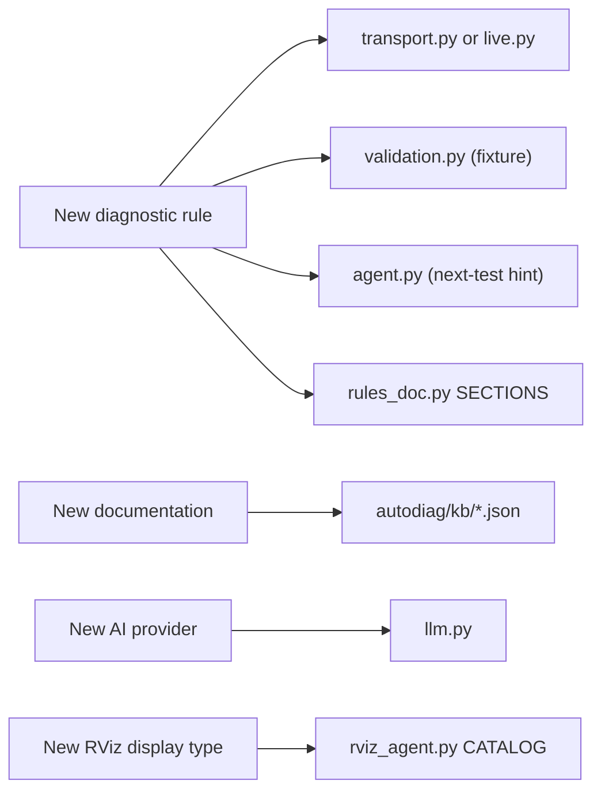

# Extending AutoDiag

The common extension points, with the files to touch.



## Add a diagnostic rule

1. **Write the check.**
    - *Snapshot rule* (environment or cross-host): in `transport_diagnose()` or `_environment_rules()` in
      `autodiag/transport.py`, using
      `_issue(code, severity, summary, evidence, action, doc=None, confidence='medium')`.
    - *Live topic rule* (QoS or type): in `_qos_findings()` in `autodiag/live.py`.
2. **Link documentation** with a key from `autodiag/knowledge.py`; add an official URL and a title (`TITLES`) there if
   needed.
3. **Add a fixture** to `FIXTURES` in `autodiag/validation.py`: for a snapshot rule, the smallest one or two snapshots
   (`a`, `b`) that trigger it; for a live rule, a list of `endpoints`. `selftest` picks it up automatically.
4. **Add a next-test hint** to `ISSUE_DOCS` in `autodiag/agent.py`.
5. **Document it:** add the rule's row (code, symptom, runs with, fixtures) to `SECTIONS` in `autodiag/rules_doc.py`,
   then regenerate [Diagnostic rules](../reference/rules.md) with
   `python -m autodiag.rules_doc > docs/reference/rules.md`. Never edit that page by hand; a test fails if a rule is
   missing or the page drifts.
6. **Test** in `tests/`.

!!! tip "Good rules"
    Trigger only on observable evidence, include that evidence, and choose `warning` when the outcome depends on
    something AutoDiag can't see.

## Add documentation to the knowledge base

Create `autodiag/kb/<id>.json`:

```json
{
  "id": "nav2-map-qos",
  "title": "Nav2 map topic QoS",
  "url": "https://docs.nav2.org/…",
  "keywords": "nav2 map transient_local durability latched",
  "text": "A short, accurate summary in your own words …"
}
```

The URL must be HTTPS and official. Write a summary rather than copying documentation, then restart the server. With
semantic search, new or changed entries are re-embedded automatically (the cache key is model + id + text); deleting
the embedding cache only frees disk space.

## Add an AI provider

In `autodiag/llm.py`:

1. Add an entry to `PROVIDERS`: label, `needs_key`, `cloud` (whether findings are masked and sent off the machine),
   environment variables, default and suggested models, and `needs_base_url` if the user supplies an endpoint.
2. Implement streaming (`_stream_<name>`, or reuse `_stream_openai_style` for OpenAI-style APIs) and add a branch for
   it in `stream_answer()`; add structured output to `complete_json()` if the provider needs its own request.
3. Map HTTP and SDK errors to `ProviderError` with clear messages, never including keys.
4. Add model listing to `_fetch_models()`.

Most hosted models are reachable through the existing **OpenAI-compatible** provider without code changes.

## Add an RViz display type

Add an entry to `CATALOG` in `autodiag/rviz_agent.py`:

```python
'Imu': {'class_id': 'rviz_imu_plugin/Imu', 'types': ['sensor_msgs/msg/Imu'],
        'props': {**QOS_PROPS}},   # add display-specific properties exactly as RViz names them
```

`topic_prop` names the display's topic property; it defaults to `"Topic"` and is `None` for topic-less displays such
as TF, Grid and Axes (which also have empty `types`). Use the exact class id and property names RViz shows. Optionally add a conventional topic to `DEFAULT_TOPICS`, and
add the words users would say for it to `TYPE_WORDS` (e.g. `'Imu': ('imu', 'orientation')`) so the slim prompt
retrieves it. Plugin display types only work when that plugin is installed. Run `dds-autodiag bench` before and after
to check plans did not get worse.
