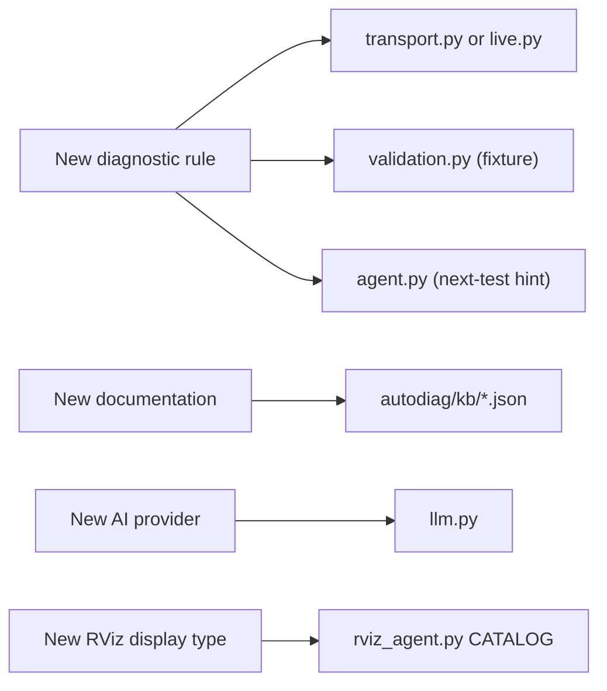

# Extending AutoDiag

The common extension points, with the files to touch.



## Add a diagnostic rule

1. **Write the check** in `autodiag/transport.py` (environment or cross-host) or `autodiag/live.py` (topic QoS).
   Use `_issue(code, severity, summary, evidence, action, doc_key, confidence)`.
2. **Link documentation** with a key from `autodiag/knowledge.py`; add an official URL there if needed.
3. **Add a fixture** to `FIXTURES` in `autodiag/validation.py`: the smallest pair of snapshots that triggers the
   rule. `selftest` picks it up automatically.
4. **Add a next-test hint** to `ISSUE_DOCS` in `autodiag/agent.py`.
5. **Test** in `tests/`, and regenerate or update [Diagnostic rules](../reference/rules.md).

!!! tip "Good rules"
    Trigger only on observable evidence, include that evidence, and choose `warning` when the outcome depends on
    something AutoDiag can't see.

## Add documentation to the knowledge base

Create `autodiag/kb/<id>.json`:

```json
{
  "id": "nav2-map-qos",
  "title": "Nav2 map topic QoS",
  "url": "https://docs.nav2.org/…",
  "keywords": "nav2 map transient_local durability latched",
  "text": "A short, accurate summary in your own words …"
}
```

The URL must be HTTPS and official. Write a summary rather than copying documentation. Restart the server; delete the
embedding cache if semantic search is used.

## Add an AI provider

In `autodiag/llm.py`:

1. Add an entry to `PROVIDERS` (label, whether it needs a key, environment variables, default and suggested models).
2. Implement streaming (`_stream_<name>`) and structured output in `complete_json()`.
3. Map HTTP and SDK errors to `ProviderError` with clear messages, never including keys.
4. Add model listing to `_fetch_models()`.

Most hosted models are reachable through the existing **OpenAI-compatible** provider without code changes.

## Add an RViz display type

Add an entry to `CATALOG` in `autodiag/rviz_agent.py`:

```python
'Imu': {'class_id': 'rviz_imu_plugin/Imu', 'types': ['sensor_msgs/msg/Imu'],
        'props': {**QOS_PROPS}},   # add display-specific properties exactly as RViz names them
```

Use the exact class id and property names RViz shows. Optionally add a conventional topic to `DEFAULT_TOPICS`. Plugin
display types only work when that plugin is installed.
