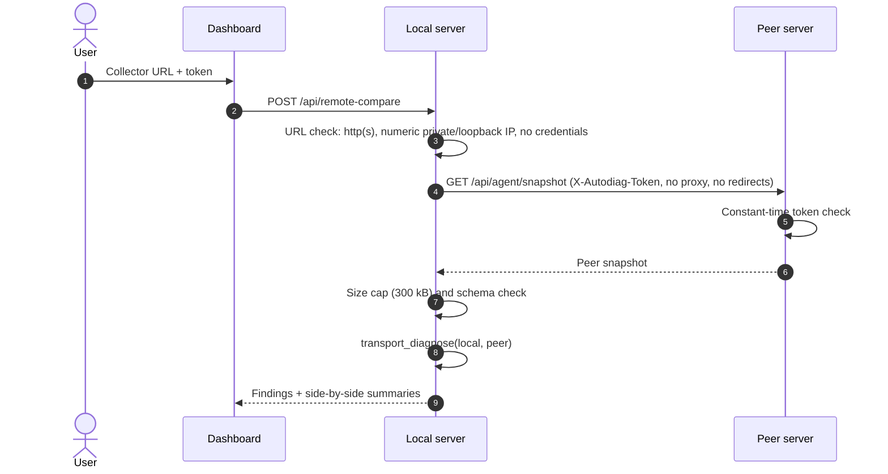
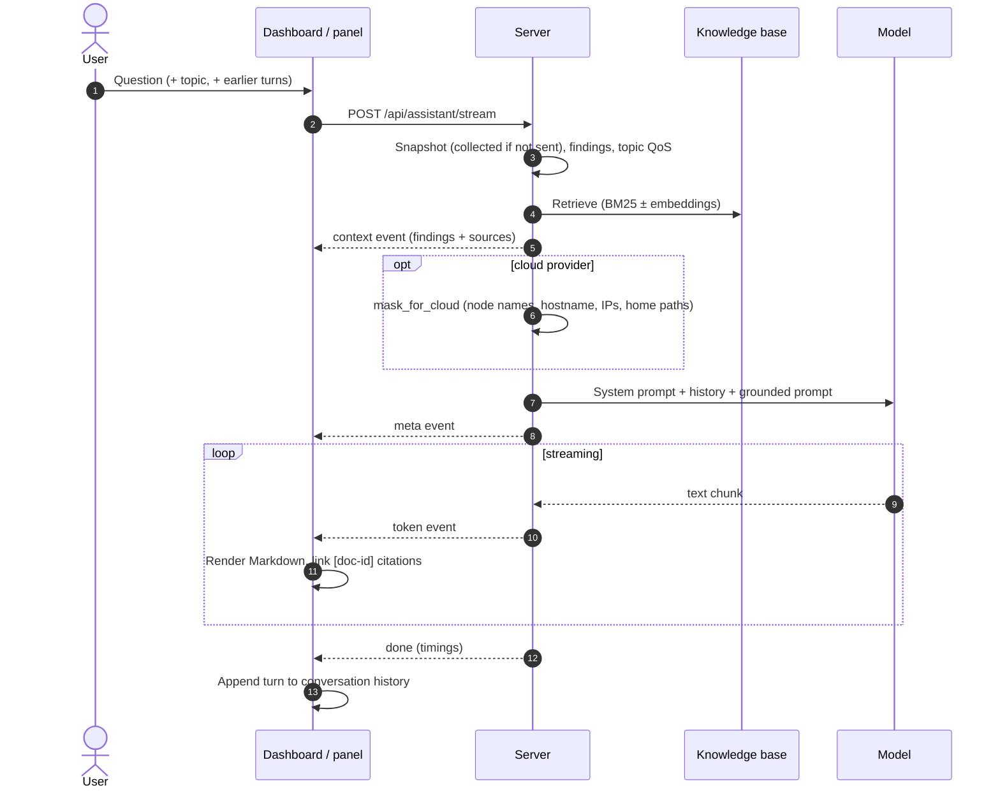
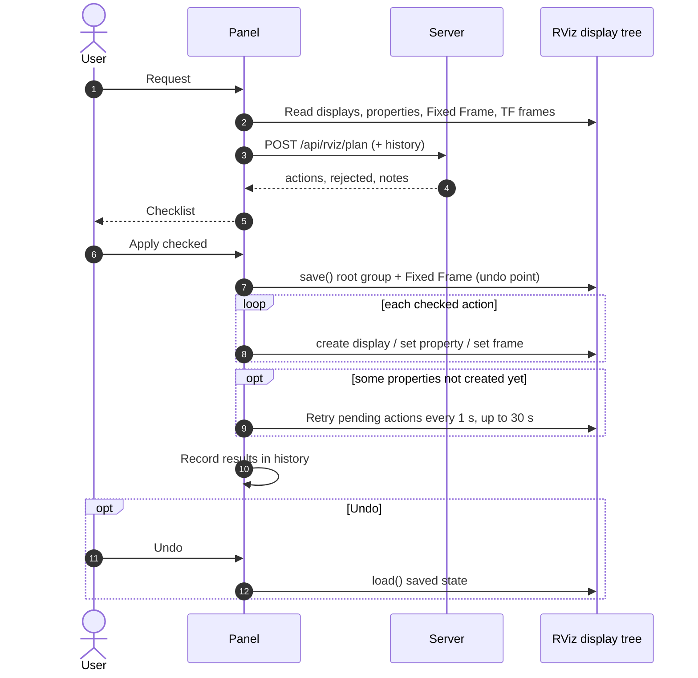
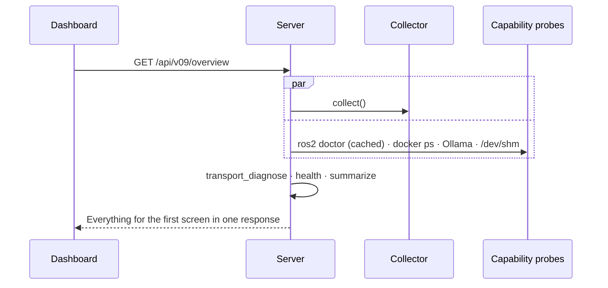

# Runtime flows

How the main features work at runtime, step by step.

## Compare with a live collector

Failures name the cause: connection refused, timeout, rejected token, or an unexpected HTTP status.

## Ask the AI assistant

## Configure RViz: plan, apply, undo

## Dashboard overview

