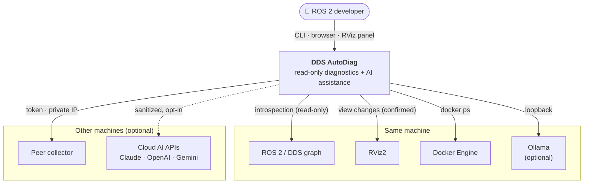

# Architecture overview

This section explains how DDS AutoDiag is built and why. It follows the [C4 model](https://c4model.com/): from the
system in its environment, to the deployable parts, to the components inside them.

--8<-- "assets/diagrams/architecture.svg"

## System context

| Boundary | What crosses it | Direction |
|---|---|---|
| ROS 2 / DDS graph | Topic lists, endpoint QoS, one sample message, `ros2 doctor` | Read only |
| RViz2 | Display tree changes, only after the user presses Apply | Write (view only) |
| Docker | Running container metadata | Read only |
| Peer collector | A snapshot, authenticated with a token | Read only |
| Ollama | Prompts and embeddings, loopback only | Local |
| Cloud AI | Assistant: question, earlier turns, rule code/severity/summary, top-3 doc excerpts, and only with "Include the topic" (panel) or for a live topic the question names (dashboard) its name, type, endpoint counts and QoS. RViz planning: request, earlier turns, display names/types/topics/properties and status, Fixed Frame, TF frame names, live topic names and types, diagnosed QoS facts. Node names, hostname, IPs and home paths are masked; snapshots, message contents and keys never leave | Opt-in, outbound |

## Quality goals

These goals drive most design decisions; see [Design decisions](decisions.md).

| Priority | Goal | What it means in practice |
|---|---|---|
| 1 | **Safety** | Never change the robot or ROS configuration. RViz changes need confirmation and are reversible |
| 2 | **Trustworthiness** | Deterministic rules decide; findings carry evidence; unverifiable things are labeled "not verified" |
| 3 | **Works offline** | Diagnosis, documentation search and local AI need no network |
| 4 | **Responsiveness** | Overview in ~3 s; AI answers start streaming within 1–2 s |
| 5 | **Low setup cost** | One Python package; RViz panel, native core and AI are optional add-ons |

## How to read this section

-   :material-package-variant-closed: [**Containers**](containers.md)

    The deployable parts and how they communicate.

-   :material-puzzle-outline: **Components**

    Inside the server and panel: [collector](components/collector.md), [rule engine](components/rule-engine.md),
    [AI layer](components/ai-layer.md), [RViz planner](components/rviz-planner.md),
    [server & security](components/server.md), [RViz panel](components/rviz-panel.md).

-   :material-code-json: [**Data model**](data-model.md)

    Snapshots, findings, plan actions and stream events.

-   :material-transit-connection-variant: [**Runtime flows**](flows.md)

    Step-by-step sequences for the main features.

-   :material-scale-balance: [**Design decisions**](decisions.md)

    Why it is built this way, as short decision records.

-   :material-puzzle-plus-outline: [**Extending**](extending.md) · [**Quality & testing**](quality.md)

    Adding rules, providers and display types; how it is tested.

