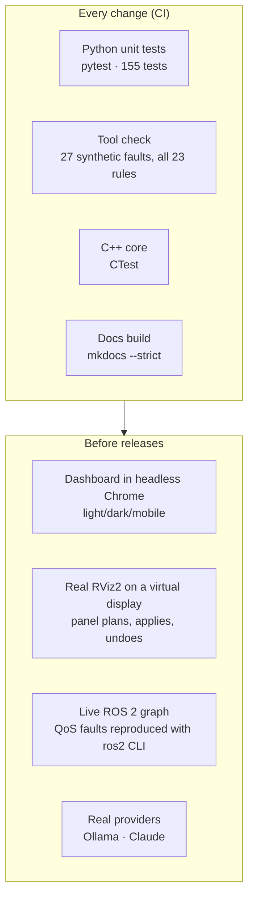

# Quality & testing

## Test strategy

| Level | What is covered | How |
|---|---|---|
| Unit | Rules, generated rules page in sync with the code, parsers, redaction, retrieval, provider request shapes, conversation building, planner validation | `pytest`, providers and subprocesses mocked |
| API | Every endpoint, security middleware, streaming format | FastAPI `TestClient` |
| Rule fixtures | Every rule triggers on its synthetic fault (27 fixtures, incl. 2 negative cases) | `dds-autodiag selftest` (Tool check) |
| Live rule check | Same codes on this host, an optional peer and this host’s graph (`fault` / `pass` / `skipped`) | `POST /api/live-rules` |
| Native | Endpoint strategy, health state machine | CTest |
| UI | Dashboard flows, no JavaScript errors, no horizontal scroll on mobile | Playwright, headless Chrome |
| RViz | Panel loaded by real RViz2: plan, apply, retry, undo; follow-up conversations | Xvfb virtual display with OpenGL |
| End to end | Real QoS mismatch on a live ROS 2 graph; real Ollama and Claude answers | Manual runs |

Tests for the optional Claude SDK skip cleanly when it isn't installed.

## CI

| Workflow | Runs | Checks |
|---|---|---|
| **CI** | Every push and PR, in `ros:jazzy-ros-base` | Python tests, rule self-test, C++ build and CTest |
| **Docs** | PRs and pushes touching docs | Strict documentation build; Pages deploy once public |

## Performance budgets

| Operation | Typical | Bound |
|---|---|---|
| Dashboard overview | ~3 s | Parallel probes; `ros2 doctor` cached 60 s |
| Topic inspection | 2–4 s | 8 s + discovery wait |
| AI first words | 1–2 s (warm local model) | Streaming |
| AI full answer | ~10–15 s local CPU · ~3–7 s cloud | 300 s local · 90 s cloud |
| RViz plan | ~60–90 s local CPU · ~6–10 s cloud | 300 s local · 120 s cloud |

## Known limitations

- Tested on ROS 2 **Jazzy** with **Fast DDS** on Ubuntu 24.04. Smoke-tested on **Humble** (`doctor`, 27 rule fixtures,
  `demo`, `check`, `inspect` in `ros:humble-ros-base`). Rolling and more Humble / Cyclone / Zenoh field reports are
  still welcome.
- A snapshot describes the collector's own environment; nodes may override RMW or domain in their launch files.
- The DDS transport selected at runtime and packet-level reachability aren't measured.
- RViz planning covers `rviz_default_plugins` display types; plugin displays need catalog entries.
- Local 4B models are slow on CPU and less reliable for complex plans; validation compensates; cloud models do better.
