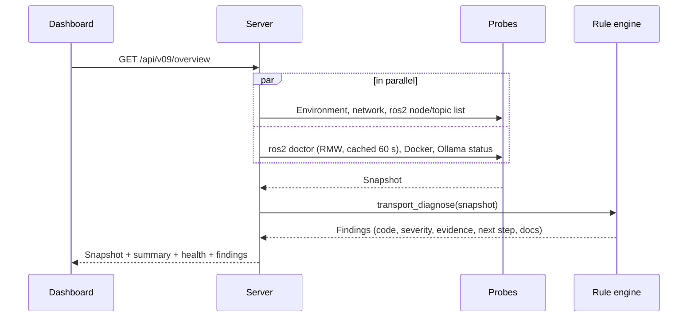

# Architecture

--8<-- "assets/diagrams/architecture.svg"

DDS AutoDiag is one local server with three interfaces in front of it and three engines behind it.

## Components

| Component | Technology | Role |
|---|---|---|
| **CLI** | Python, argparse | Diagnosis from the terminal and CI; calls the engines directly |
| **Web dashboard** | Vanilla JavaScript, strict CSP | Browser UI for every feature |
| **RViz2 panel** | C++17, Qt 5, pluginlib | Diagnostics, AI assistant and Configure RViz inside RViz |
| **Server** | FastAPI, Uvicorn | REST + NDJSON streaming API, security middleware |
| **Collector & probes** | `ros2` CLI, `ip`, `docker ps`, `/proc`, `/dev/shm` | Read-only facts about this machine |
| **Rule engine** | Pure Python | Turns snapshots into findings with evidence |
| **RAG + AI** | BM25, Ollama embeddings, multi-provider client | Grounded explanations |
| **RViz planner** | Structured output + validator | Safe, checked RViz display plans |
| **Native core** | C++20, CTest, BehaviorTree.CPP | Endpoint checks and trace viewer |

## Request flow

A dashboard refresh, for example:



Probes run in parallel and the slow `ros2 doctor` result is cached, so a refresh takes about three seconds.

## Design principles

**Read-only.** AutoDiag observes; it never restarts daemons, changes QoS, edits configuration or publishes on the
robot's topics. The RViz planner changes only the RViz view, and only after you confirm.

**Evidence over guesses.** Every finding carries the evidence that triggered it. What can't be observed (the
transport DDS selected, packet-level reachability) is reported as *not verified* instead of assumed.

**Deterministic first, AI second.** Rules decide; AI explains and plans. AI output is validated before it reaches
you, and answers are labelled as advice.

**Local by default.** The server binds to loopback, documentation search works offline, and the local model needs no
network. Cloud AI is opt-in per provider.

## Repository layout

```text
autodiag/            Python package: server, CLI, rules, probes, RAG, AI, RViz planner
autodiag/kb/         Curated documentation knowledge base (JSON)
autodiag/static/     Dashboard assets
ros2/rviz_autodiag_panel/   RViz2 panel (C++/Qt)
cpp/                 Native C++20 core and BehaviorTree.CPP runner
tests/               Python test suite
deploy/              systemd unit and environment template
docs/                This documentation
```
