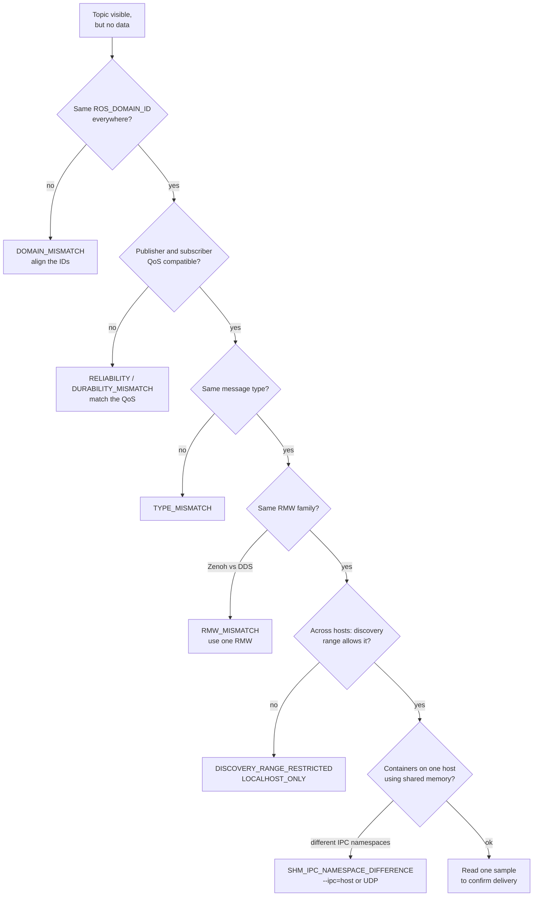

# How diagnosis works

--8<-- "assets/diagrams/diagnosis.svg"

## 1. Collect

The collector records facts about the environment it runs in:

- ROS environment variables: `ROS_DISTRO`, `ROS_DOMAIN_ID`, `RMW_IMPLEMENTATION`, discovery settings, DDS XML paths
  (and whether those files exist).
- The effective RMW, detected with `ros2 doctor`.
- Network interfaces with multicast flags (`ip -j addr`).
- Container detection and the network, IPC and PID namespaces.
- Nodes and topics visible in the ROS graph. Queries wait `AUTODIAG_DISCOVERY_SECONDS` (default 2) for DDS
  discovery, because without waiting the graph often looks incomplete.

## 2. Compare

Many problems involve two parties. With a second snapshot (another host or container), cross-host rules run too:
domain, discovery range, RMW, distro, multicast and IPC namespace.

## 3. Evaluate

Each rule is a small, testable function that produces a finding:

```json
{
  "code": "DOMAIN_MISMATCH",
  "severity": "error",
  "confidence": "high",
  "summary": "Different ROS_DOMAIN_ID values",
  "evidence": {"host_a": "0", "host_b": "7"},
  "recommended_action": "Use a consistent ROS_DOMAIN_ID across intended peers, then restart managed processes.",
  "documentation": [{"label": "domain", "url": "https://docs.ros.org/en/jazzy/Concepts/Intermediate/About-Domain-ID.html"}]
}
```

| Severity | Meaning |
|---|---|
| **error** (problem) | A confirmed configuration that prevents communication |
| **warning** | Likely to cause problems, or unsupported |
| **info** (note) | Worth knowing; not a fault |

`dds-autodiag selftest` runs every rule against a synthetic fault, so you can verify the rules on any installation.

## 4. Explain

Every finding links to official documentation. On request, the AI assistant explains the findings in context; see
[RAG & AI pipeline](rag.md).

## 5. Verify

Configuration can be correct while data still doesn't flow, so the last step is always a real message:
**Read one sample** in the dashboard, or `dds-autodiag sample /topic`.

## Debugging "topic visible, no data"

This is the most common ROS 2 complaint. AutoDiag follows the same path an expert would:



## What AutoDiag can't see

It says so instead of guessing:

- A snapshot describes the collector's own environment. A node can set its own RMW or domain in its launch file.
- The transport DDS actually selected at runtime (shared memory vs UDP) isn't measured.
- Packet-level reachability between hosts isn't tested.
