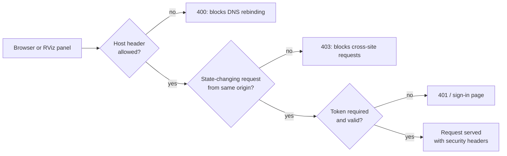

# Security model

AutoDiag runs commands on your machine and can hold API keys, so it's built to be safe by default.

## Read-only

AutoDiag runs `ros2` introspection commands (`topic list/info/echo --once`, `node list`, `doctor`), `ip` and
`docker ps`. It never restarts daemons, changes QoS, edits configuration, or publishes on your robot's topics. Topic
names are validated before any command runs, and commands are executed without a shell, with timeouts and output
limits.

The only thing that ever changes is your **RViz view**, through Configure RViz, and only after you press Apply.

## Network exposure

| Protection | Details |
|---|---|
| Loopback by default | `serve` binds to `127.0.0.1` and refuses other addresses unless `AUTODIAG_UI_TOKEN` is set (or `--insecure-no-auth` is given explicitly) |
| Token login | Sign-in page or `Authorization: Bearer`; HttpOnly, SameSite=Strict cookie; constant-time comparison |
| Host-header allow-list | Blocks DNS-rebinding attacks against the local server; extend it with `AUTODIAG_ALLOWED_HOSTS` |
| Origin check | Rejects cross-site POST/PUT/DELETE |
| Headers | Strict Content-Security-Policy (no inline script), `X-Frame-Options: DENY`, `nosniff`, `no-referrer`, `no-store` |
| No TLS of its own | Use an SSH tunnel or a TLS reverse proxy for remote access |

## Remote collector

`/api/agent/snapshot` only exists when `AUTODIAG_AGENT_TOKEN` is set. When fetching from a peer, AutoDiag accepts only
numeric private or loopback IPs, disables proxies and redirects, and caps the response size.

## API keys

- Stored server-side in `~/.config/dds-autodiag/ai-providers.json`, file mode `0600`, written atomically.
- Never returned to the browser; the UI shows the last four characters only.
- Never written to logs.
- Environment variables override the stored file.

## Data sent to AI providers

Local Ollama only accepts loopback URLs. For cloud providers, AutoDiag sends the minimum needed:

- **Assistant:** finding codes and summaries, your question, documentation excerpts, earlier turns.
- **Configure RViz:** your request, display settings, topic names and types, TF frame names.

Snapshots, hostnames, IP addresses and message contents are never sent.

## Sharing snapshots

Snapshots contain hostnames, IPs and paths. `dds-autodiag collect --redact` (or the dashboard's default export)
replaces them with salted hashes while keeping diagnostic values such as domain, RMW and QoS.

## Reporting a vulnerability

Please report security issues privately through GitHub's **Security → Report a vulnerability** on the repository,
not in a public issue.
