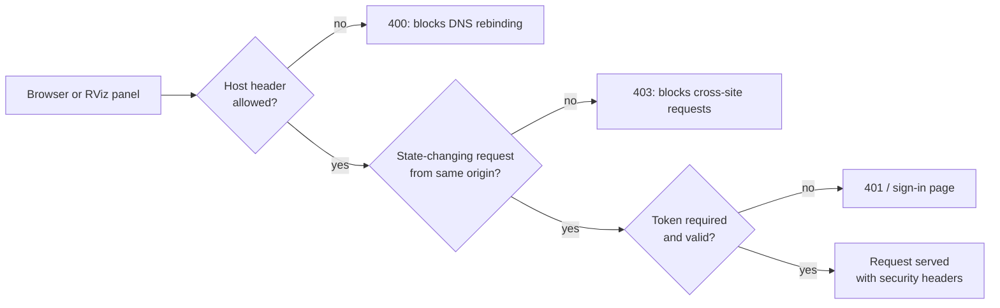

# Security model

AutoDiag runs commands on your machine and can hold API keys, so it's built to be safe by default.

## Read-only

AutoDiag runs `ros2` introspection commands (`topic list/info/echo --once`, `node list`, `daemon status`,
`doctor --report`), `ip` and `docker ps`. It never restarts daemons, changes QoS, edits configuration, or publishes on
your robot's topics. Topic names are validated before any command runs, and commands are executed without a shell,
with timeouts and output limits.

There are two exceptions, both started by you: Configure RViz changes your **RViz view**, and only after you press
Apply; `dds-autodiag demo` publishes on its own `/autodiag_demo/*` topics.

## Network exposure

| Protection | Details |
|---|---|
| Loopback by default | `serve` binds to `127.0.0.1` and refuses other addresses unless `AUTODIAG_UI_TOKEN` is set (or `--insecure-no-auth` is given explicitly) |
| Token login | Sign-in page or `Authorization: Bearer`; HttpOnly, SameSite=Strict cookie; constant-time comparison |
| Host-header allow-list | Blocks DNS-rebinding attacks against the local server; extend it with `AUTODIAG_ALLOWED_HOSTS` |
| Origin check | Rejects cross-site POST/PUT/DELETE |
| Headers | Strict Content-Security-Policy (no inline script) for the dashboard (`/legacy` and `/api/docs` allow inline script), `X-Frame-Options: DENY`, `nosniff`, `no-referrer`, `no-store` |
| No TLS of its own | Use an SSH tunnel or a TLS reverse proxy for remote access |

## Remote collector

`/api/agent/snapshot` always exists but answers 403 unless `AUTODIAG_AGENT_TOKEN` is set and sent as
`X-Autodiag-Token`. When fetching from a peer, AutoDiag accepts only numeric private or loopback IPs, disables proxies
and redirects, and caps the response size.

## API keys

- Stored server-side in `$XDG_CONFIG_HOME/dds-autodiag/ai-providers.json` (by default `~/.config/dds-autodiag/`),
  file mode `0600`, written atomically.
- Never returned to the browser; the UI shows the last four characters only.
- Never written to logs.
- Environment variables override the stored file.

## Data sent to AI providers

Local Ollama only accepts loopback URLs. AutoDiag sends the minimum needed:

| Feature | Sent | Never sent |
|---|---|---|
| Assistant | Your question; earlier turns of the conversation (your questions and previous answers); code, severity and summary of each finding; the top three documentation excerpts; only with **Include the topic** (RViz panel) or for a live topic your question names (dashboard): topic name, message type, endpoint counts and QoS | Snapshots, message contents, node names (to cloud providers), hostnames, IP addresses, home paths, API keys |
| Configure RViz | Your request; earlier turns; display names, types, topics, properties and status; Fixed Frame; TF frame names; live topic names and types; diagnosed QoS facts | Snapshots, message contents, node names, hostnames, IP addresses, home paths, API keys |

For cloud providers, the text is masked first: node names become `publisher 1`, `subscriber 1`, …, and this machine's
hostname, IP addresses and home paths are replaced with tokens. Local Ollama gets the real names, and the UI always
shows the real names. In the assistant, your own question is sent as you typed it.

## Sharing snapshots

Snapshots contain hostnames, IPs and paths. `dds-autodiag collect --redact` (or the dashboard's default export)
replaces them with salted hashes while keeping diagnostic values such as domain, RMW and QoS. The salt is random
unless you pass `--salt`; the CLI prints it, so you can redact the other host with the same `--salt` and still
compare the two.

## Reporting a vulnerability

Please report security issues privately through GitHub's **Security → Report a vulnerability** on the repository,
not in a public issue.
