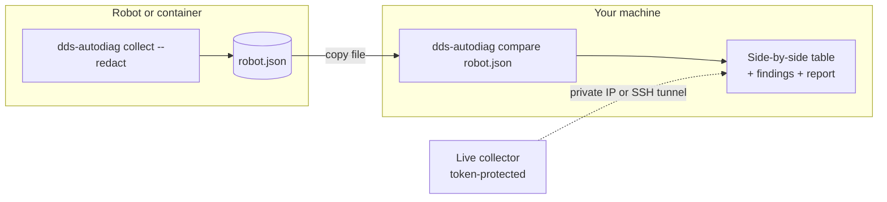

# Compare hosts & containers

Many ROS 2 problems only appear between **two** machines: a robot and a laptop, or two containers. AutoDiag compares
their environments side by side.



## Option A: snapshot files (recommended)

On the robot or inside the container, with ROS 2 sourced:

```bash
dds-autodiag collect --redact --salt team42 -o robot.json
```

On your machine:

```bash
dds-autodiag compare robot.json --report report.md
```

Or load `robot.json` in the dashboard under **Compare hosts**.

!!! tip "Redaction keeps comparisons working"
    `--redact` replaces hostnames, IP addresses and home paths with short hashes. Use the **same `--salt`** on both
    sides, so the same value always hashes to the same token and the comparison still works.

## Option B: live collector

On the peer, start AutoDiag with a collector token:

```bash
AUTODIAG_AGENT_TOKEN=<long-random-secret> dds-autodiag serve --port 8081
```

In your dashboard, open **Compare hosts → Connect to a live collector** and enter `http://<private-ip>:8081` and the
token. For security, the collector is only fetched from private or loopback IPs, without proxies or redirects, and
with a size limit. Over the internet, use an SSH tunnel:

```bash
ssh -L 8081:127.0.0.1:8081 robot
```

## Docker containers

The **Docker** section lists running containers and the command to collect a snapshot from each:

```bash
docker exec my-container bash -lc "dds-autodiag collect" > my-container.json
```

AutoDiag must be installed inside the container for this. For shared memory between containers, also run
`dds-autodiag check --transport dds_shm` on both sides; different IPC namespaces show up as
[`SHM_IPC_NAMESPACE_DIFFERENCE`](../reference/rules.md#shm_ipc_namespace_difference).

## What gets compared

| Row | Typical finding |
|---|---|
| Domain ID | [`DOMAIN_MISMATCH`](../reference/rules.md#domain_mismatch) |
| RMW | [`RMW_MISMATCH`](../reference/rules.md#rmw_mismatch) (Zenoh vs DDS is an error) |
| ROS distro | [`DISTRO_MISMATCH`](../reference/rules.md#distro_mismatch) |
| Discovery range | [`DISCOVERY_RANGE_RESTRICTED`](../reference/rules.md#discovery_range_restricted), [`LOCALHOST_ONLY`](../reference/rules.md#localhost_only) |
| Network interfaces | [`MULTICAST_CAPABILITY_ABSENT`](../reference/rules.md#multicast_capability_absent) |
| IPC namespace | [`SHM_IPC_NAMESPACE_DIFFERENCE`](../reference/rules.md#shm_ipc_namespace_difference) |
