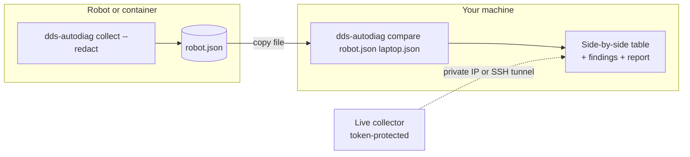

# Compare hosts & containers

Many ROS 2 problems only appear between **two** machines: a robot and a laptop, or two containers. AutoDiag compares
their environments side by side.



## Option A: snapshot files (recommended)

On the robot or inside the container, with ROS 2 sourced:

```bash
dds-autodiag collect --redact --salt team42 -o robot.json
```

On your machine, redact a snapshot with the **same salt** and compare the two files:

```bash
dds-autodiag collect --redact --salt team42 -o laptop.json
dds-autodiag compare robot.json laptop.json --report report.md
```

Without `--salt`, `collect --redact` picks a random salt and prints it to stderr, so you can reuse it on the other
side.

!!! tip "Redaction keeps comparisons working"
    `--redact` replaces hostnames, IP addresses and home paths with short hashes. With the **same `--salt`** on both
    sides, the same value always hashes to the same token and the comparison still works.

!!! warning "Redacted file vs. the live host"
    `dds-autodiag compare robot.json` (or loading `robot.json` in the dashboard under **Hosts**) compares the
    file with this host's *unredacted* snapshot. Domain, RMW, distro and discovery rows still work, but the hashed
    hostname never equals the real one, so rules that check for the same host always see "different hosts". For
    containers on one host, collect without `--redact`, or redact both sides and compare the two files.

## Option B: live collector

On the peer, start AutoDiag with a collector token, listening on the network (a non-loopback bind also needs the
dashboard token, and the IP you connect to must be an allowed host):

```bash
AUTODIAG_AGENT_TOKEN=<long-random-secret> AUTODIAG_UI_TOKEN=<another-secret> \
AUTODIAG_ALLOWED_HOSTS=<private-ip> dds-autodiag serve --host 0.0.0.0 --port 8081
```

In your dashboard, open **Hosts → Connect to a live collector** and enter `http://<private-ip>:8081` and the
collector token. For security, the collector is only fetched from private or loopback IPs, without proxies or
redirects, and with a size limit.

Over the internet, use an SSH tunnel instead. The peer can then stay on `127.0.0.1`
(`AUTODIAG_AGENT_TOKEN=<long-random-secret> dds-autodiag serve --port 8081`), and you enter `http://127.0.0.1:8081`:

```bash
ssh -L 8081:127.0.0.1:8081 robot
```

## Docker containers

The **Local Docker environments** card lists running containers and the command to collect a snapshot from each:

```bash
docker exec my-container bash -lc "dds-autodiag collect" > my-container.json
```

AutoDiag must be installed inside the container for this. For shared memory between containers,
[`SHM_IPC_NAMESPACE_DIFFERENCE`](../reference/rules.md#shm_ipc_namespace_difference) is a two-snapshot rule: collect
in both containers, then compare the two files with the transport you expect:

```bash
docker exec container-a bash -lc "dds-autodiag collect" > a.json
docker exec container-b bash -lc "dds-autodiag collect" > b.json
dds-autodiag compare a.json b.json --transport dds_shm
```

The rule needs both snapshots detected as containers and the same host identity. Docker gives each container its own
hostname, unless they share the UTS namespace (`--uts=host`) or you set the same `--hostname`.

## What gets compared

| Row | Typical finding |
|---|---|
| Domain ID | [`DOMAIN_MISMATCH`](../reference/rules.md#domain_mismatch) |
| RMW | [`RMW_MISMATCH`](../reference/rules.md#rmw_mismatch) (Zenoh vs DDS is an error) |
| ROS distro | [`DISTRO_MISMATCH`](../reference/rules.md#distro_mismatch) |
| Discovery range | [`DISCOVERY_RANGE_RESTRICTED`](../reference/rules.md#discovery_range_restricted), [`LOCALHOST_ONLY`](../reference/rules.md#localhost_only) |
| Network interfaces | [`MULTICAST_CAPABILITY_ABSENT`](../reference/rules.md#multicast_capability_absent) |
| IPC namespace | [`SHM_IPC_NAMESPACE_DIFFERENCE`](../reference/rules.md#shm_ipc_namespace_difference) |
