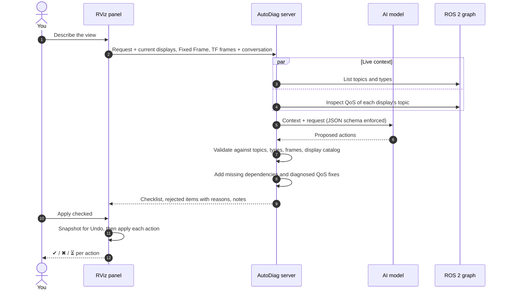

# Configure RViz with AI

Describe the view you want in plain language. The AI proposes display changes, AutoDiag checks every one of them
against your live system, and nothing changes until you press **Apply**.

--8<-- "assets/diagrams/configure-rviz.svg"

## Example

> *Show the lidar point cloud colored by height in the base_link frame, keep it light-weight. My laser scan shows
> nothing.*

The plan appears as a checklist:

- [x] Add PointCloud2 display "Lidar Cloud" on `/lidar/points`
- [x] Set Color Transformer of "Lidar Cloud" to AxisColor *(needed for Axis)*
- [x] Set Axis of "Lidar Cloud" to Z
- [x] Set Style of "Lidar Cloud" to Points
- [x] Set Decay Time of "Lidar Cloud" to 0
- [x] Set Topic/Depth of "Lidar Cloud" to 1
- [x] Set Topic/Reliability Policy of "LaserScan" to Best Effort *(AutoDiag QoS fix)*
- [x] Set Fixed Frame to base_link *(from your request)*

Untick anything you don't want, then press **Apply checked**. Each line gets ✔ applied, ✖ failed (with the reason),
or ⏳ waiting for data.

## What happens behind the scenes

## What the AI can change

| Action | Example |
|---|---|
| Add a display | PointCloud2 on `/points`, Map on `/map`, TF |
| Remove a display | "remove the old laser scan" |
| Set the topic | "use `/front/scan` instead" |
| Set a property | Style, Size, Color Transformer, Axis, Decay Time, Alpha, QoS (`Topic/Reliability Policy`, `Topic/Depth`…) |
| Enable or disable | "hide the map" |
| Rename | "call it Front Lidar" |
| Set the Fixed Frame | "view everything in `base_link`" |

Supported display types: PointCloud2, PointCloud, LaserScan, Image, Camera, DepthCloud, Map, Path, Odometry, Pose,
PoseWithCovariance, PoseArray, PointStamped, Polygon, Marker, MarkerArray, Range, GridCells, TwistStamped, Wrench,
TF, Grid, Axes and RobotModel.

## The safety net

Small models in particular make mistakes. AutoDiag doesn't trust the plan blindly:

!!! success "Validated"
    Unknown display types, missing displays and topics that exist **with the wrong message type** are rejected with
    a reason. Display-name typos like `laser_scan` vs `LaserScan` are matched.

!!! success "Completed"
    Dependent settings the model forgot are added (for example `Color Transformer: AxisColor` when it only set
    `Axis`). A frame named in your request is applied even if the model skipped it.

!!! success "Diagnosed"
    AutoDiag inspects each display's topic itself. If the publisher offers Best Effort but the display requests
    Reliable, the QoS fix is added, regardless of what the model proposed.

!!! success "Reversible"
    Every Apply takes a snapshot first. **Undo** restores all displays and the Fixed Frame from before the last
    Apply.

## Before any data exists

You can set up RViz before your sensors run. Displays are added with the topic you name, or the conventional one
(`/scan`, `/points`, `/camera/image_raw`, `/map`, `/odom`, …), and marked **not publishing yet**. Settings that
only appear once data arrives are retried for up to 30 seconds.

## Conversations

Follow-ups work: after *"Add a point cloud for /points"* you can say *"make those points bigger and color them by
height"*, and the existing display is changed instead of a new one added. The panel remembers what was proposed,
applied, skipped, failed or undone. **New conversation** forgets it; history is never written to disk.

## Choosing a model

Pick **Provider** and **Model** at the top of the tab. It's the same selection as the AI assistant tab.

| Model | Planning time | Notes |
|---|---|---|
| Local `qwen3:4b-instruct` | about 1–2 min on a CPU | Offline; fine for simple requests |
| Claude, ChatGPT, Gemini | a few seconds | Better at complex, multi-part requests |

With a cloud model, the request, display settings, topic names/types and TF frame names are sent to that provider.

## Limits

- RViz itself can't downsample point clouds. That needs a filter node such as `pcl_ros` VoxelGrid; the AI says so in
  its notes and offers the lighter-weight display settings instead.
- Display types from extra plugins (for example `rviz_imu_plugin`) aren't in the catalog yet.
- It changes the RViz view only, never the robot, nodes or ROS configuration.
