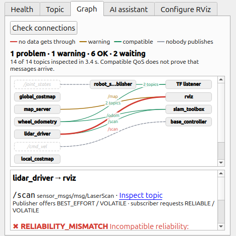

# RViz2 panel

The **AutoDiag** panel brings diagnostics and AI into RViz2, right next to the displays you're debugging.

## Install

```bash
cd ros2
source /opt/ros/jazzy/setup.bash
colcon build --packages-select rviz_autodiag_panel
source install/setup.bash
rviz2
```

In RViz: **Panels → Add New Panel → rviz_autodiag_panel → AutoDiag**.

## One command: server + RViz

```bash
source .venv/bin/activate           # dds-autodiag must be on PATH
ros2 launch rviz_autodiag_panel autodiag.launch.py
```

This starts the AutoDiag server and RViz with the panel already added and connected. Closing RViz stops the server
again.

| Argument | Default | Purpose |
|---|---|---|
| `port` | `8080` | Server port; the panel connects to it automatically |
| `start_server` | `true` | Set `false` if a server is already running (e.g. the systemd service) |
| `server_cmd` | `dds-autodiag` | Executable name or absolute path |
| `rviz_config` | the package's `rviz/autodiag.rviz` | Use your own config; add the AutoDiag panel to it once and save (see [Saved settings](#saved-settings) about `port`) |

!!! warning "The panel needs the AutoDiag server"
    The panel is a client of the server: diagnostics, documentation search and AI providers (including API keys)
    all stay there. Start it first with `dds-autodiag serve` (or use the launch file above). The browser dashboard
    doesn't need to be open.

## Connecting

The top row holds the server URL (default `http://127.0.0.1:8080`, or `AUTODIAG_SERVER_URL` if set; a URL saved in
the `.rviz` file overrides both), **Connect**, and **Dashboard**, which opens the current view in the web dashboard (Health → Overview, Topic →
Topics, Graph → Graph, AI assistant → Assistant). If the server isn't up yet,
the panel keeps trying for about 30 seconds. If the server requires a token, enter it in the token field or start
RViz with `AUTODIAG_UI_TOKEN` set.

## The five tabs

=== "Health"

    The overall status and every finding for this machine, sorted by severity. Hover a finding to see its next
    step. Tick **every 30 s** for automatic refresh.

=== "Topic"

    Pick a topic and press **Inspect** to see publishers, subscribers and QoS, with incompatibilities marked.
    Topics used by your RViz displays are listed first, and **⚠** marks a display that currently reports a
    problem. That's usually the one to inspect.

=== "Graph"

    Every publisher → subscriber connection on the visible topics, checked with the same QoS and type rules: red
    means no data gets through, orange a warning (for example a Volatile display on a latched map), green
    compatible, and a dashed line a subscriber that nobody publishes to. The check runs the first time you open the
    tab (a few seconds; **Check connections** repeats it), opens the worst connection right away and scales to the
    width of the dock. Click a line for its finding, next step and documentation; **Inspect topic** jumps to the
    Topic tab.

    { width="420" }

=== "AI assistant"

    Ask about your system in plain language. The answer streams in, cites official documentation as clickable
    links, and includes the selected topic's live endpoints and QoS as context when *Include the topic* is
    ticked. Follow-up questions keep the conversation; **New conversation** starts fresh.

=== "Configure RViz"

    Describe the view you want, and the AI plans display changes that AutoDiag validates before you apply them.
    This one gets its own guide: [Configure RViz with AI](configure-rviz.md).

## Making the panel bigger

RViz panels are dock widgets:

- **Double-click the panel's title bar** to float it as a separate, resizable window, for example full height on a
  second monitor. Double-click again to dock it.
- Or drag the divider between the panel column and the 3D view.
- **File → Save Config** remembers the layout.

## Saved settings

The server URL, provider, model, selected topic, **Include the topic** and **every 30 s** are stored in your `.rviz`
file. The access token is deliberately **not** saved, because `.rviz` files are often shared.

A saved server URL overrides `AUTODIAG_SERVER_URL`, so once you've saved your own config, the launch file's `port:=`
no longer reaches the panel; change the URL in the panel (and save again) instead.
